<p align="center">
  
</p>

<p align="center">
  <a href="https://www.anypayx.com"></a>
  <a href="https://github.com/anypay/prices-rs"></a>
  <a href="https://brew.sh"></a>
</p>

<p align="center">
  <a href="https://www.anypayx.com">Website</a> ·
  <a href="https://www.anypayx.com/docs">Docs</a> ·
  <a href="https://www.anypayx.com/prices">Prices</a> ·
  <a href="https://github.com/anypay/prices-rs">Source</a> ·
  <a href="https://github.com/anypay">GitHub</a>
</p>

---

## What It Is & Purpose

The **Prices Homebrew Tap** is Anypay's official Homebrew distribution channel for the **Prices CLI** — a lightweight Rust-powered command-line tool that delivers real-time cryptocurrency price feeds from multiple exchanges. This tap simplifies installation and updates for macOS users, providing native ARM and AMD64 binaries that connect to Anypay's aggregated price infrastructure.

The Prices CLI is essential for merchants, developers, and applications that need reliable, up-to-the-second crypto quotes for Bitcoin, stablecoins (USDC, USDT, RLUSD, NUSD), Ethereum, Solana, XRP, and other supported chains. It powers invoice calculations, treasury management dashboards, trading bots, and payment gateway integrations across the Anypay ecosystem.

This tap eliminates manual binary downloads and version tracking, letting Homebrew handle the full lifecycle — tap once, install, upgrade seamlessly.

## Why Use It

**Effortless installation.** One `brew tap` command grants access to the entire Anypay toolchain. No `curl` scripts, no GitHub release hunting, no manual PATH configuration. Homebrew manages the binary, keeps it current, and uninstalls cleanly.

**Production-grade price feeds.** The Prices binary connects to Anypay's aggregated price service, which polls Coinbase, Binance, Kraken, and other tier-1 exchanges every few seconds. Merchants see the same rates their invoices use. Developers building against Anypay's API get parity between local testing and production.

**Native performance.** The tap serves pre-compiled Rust binaries for Apple Silicon (`arm64`) and Intel (`x86_64`), so startup is instant and memory footprint stays minimal. No Docker, no virtual environment, no interpreter overhead.

- **Who it's for:** macOS developers building crypto payment flows, merchants running local dashboards, DevOps teams scripting treasury checks, and anyone testing Anypay invoice logic without hitting the live API.
- **Where it fits:** This tap is the official macOS distribution mechanism for [`anypay/prices-rs`](https://github.com/anypay/prices-rs). The CLI binary is also used internally by Anypay's invoice service, merchant app, and WalletBot settlement engine.

## How It Works

<p align="center">
  
</p>

### Installation Flow

1. **`brew tap anypay/prices`** — Homebrew clones this repository into `/usr/local/Homebrew/Library/Taps/anypay/homebrew-prices` (Intel) or `/opt/homebrew/Library/Taps/anypay/homebrew-prices` (ARM), making the `prices` formula available.

2. **Formula Resolution** — When you run `brew install prices`, Homebrew evaluates `prices.rb`, which declares the download URLs for both architectures, checksums, and installation steps. The formula automatically selects the correct binary (ARM or AMD64) based on your Mac's architecture.

3. **Prices Binary** — Homebrew downloads the signed `.zip` archive from the [`prices-rs` GitHub releases](https://github.com/anypay/prices-rs/releases), verifies its SHA-256 hash, extracts the `prices` executable, and installs it to `/usr/local/bin/prices` (Intel) or `/opt/homebrew/bin/prices` (ARM).

4. **Live Crypto Quotes** — The `prices` binary connects to Anypay's price aggregation service over HTTPS. It polls supported exchanges every few seconds, caches results locally, and exposes them via CLI commands, JSON output, or a local REST/WebSocket server (depending on invocation flags).

## Quickstart / How to Use It

### Install

Tap the Anypay repository and install the Prices CLI:

```bash
brew tap anypay/prices
brew install prices
```

### Verify Installation

Check the installed version:

```bash
prices --version
```

Expected output: `prices 0.0.17` (or the current release version).

### Basic Usage

Fetch real-time price for Bitcoin in USD:

```bash
prices btc
```

Get a comprehensive quote with exchange breakdown:

```bash
prices eth --verbose
```

Run a local price server (if supported by your version):

```bash
prices serve --port 8080
```

The binary's full capabilities depend on the [`prices-rs`](https://github.com/anypay/prices-rs) implementation. Check the upstream README for REST endpoints, WebSocket streams, and supported currency pairs.

### Upgrade

When a new version of `prices-rs` is released and this tap is updated, upgrade with:

```bash
brew upgrade prices
```

Homebrew will automatically fetch the new binary and replace the old one.

### Uninstall

Remove the CLI cleanly:

```bash
brew uninstall prices
```

To stop tracking this tap entirely:

```bash
brew untap anypay/prices
```

## Next Moves for Growth

This tap is functional and stable, but several high-leverage improvements would streamline maintenance and expand reach:

1. **Automate Formula Updates** — The current process requires manually downloading each new `prices-rs` release, computing SHA-256 hashes for both architectures, and editing `prices.rb`. A GitHub Actions workflow triggered on new releases in `anypay/prices-rs` could generate a PR here automatically, with the updated version and checksums already filled in. This eliminates human error and reduces release latency to minutes.

2. **Add CI Formula Validation** — Set up `brew audit --strict --online prices` and `brew install --build-from-source prices` in CI (using macOS runners for both ARM and Intel). This catches formula syntax errors, missing dependencies, and broken URLs before they reach users. GitHub Actions offers free macOS runners for open-source projects.

3. **Publish to Homebrew Core** — Once the Prices CLI reaches stable 1.0 status, submit the formula to [Homebrew/homebrew-core](https://github.com/Homebrew/homebrew-core). This would let users run `brew install prices` directly, without tapping `anypay/prices` first. Core inclusion requires 75+ stars, 30+ forks, or notable user base — Anypay's existing merchant footprint likely qualifies.

4. **Multi-Platform Support via Homebrew on Linux** — Homebrew runs on Linux (`brew.sh` supports Ubuntu, Debian, Fedora). If `prices-rs` ships Linux binaries, extend this tap's formula with `on_linux` blocks to serve x86_64 and ARM64 Linux users. This unifies CLI distribution across macOS and Linux developer environments.

5. **Add a `cask` for GUI Builds** — If Anypay ships a macOS app bundle for Prices (Electron, Tauri, or native Swift), create a Homebrew Cask formula in this tap. Casks handle `.app` installations, DMG mounts, and auto-update metadata, giving non-terminal users a native macOS experience.

## Anypay Ecosystem & License

**Prices Homebrew Tap** is part of [Anypay](https://www.anypayx.com) — Bitcoin & Stablecoin payments for business. Merchants and developers use Anypay to accept BTC, ETH, and stablecoins such as USDC, USDT, RLUSD, and NUSD through invoices, APIs, SDKs, webhooks, WooCommerce, and mobile POS.

| Project | Role |
| --- | --- |
| [prices-rs](https://github.com/anypay/prices-rs) | Rust-based price aggregator (the binary this tap installs) |
| [anypay](https://github.com/anypay/anypay) | Invoice & payments platform / API (`@anypay/server`) |
| [anypay-sdk](https://github.com/anypay/anypay-sdk) | TypeScript SDK for browser & Node.js (`@anypay/client`) |
| [web3-checkout-vite](https://github.com/anypay/web3-checkout-vite) | Current checkout UI (`checkout.anypayx.com`) |
| [walletbot](https://github.com/anypay/walletbot) | Self-custody headless wallet (`@anypay/walletbot`) |

### Related Repositories

- **[prices-rs](https://github.com/anypay/prices-rs)** — The upstream Rust implementation this tap distributes. File price-service bugs, feature requests, and API questions there.
- **[anypay](https://github.com/anypay/anypay)** — The core Anypay platform uses this same price feed to calculate invoice amounts in crypto, ensuring merchants receive the correct on-chain value at payment time.

### License

This repository (`homebrew-prices`) contains **only the Homebrew formula** (a Ruby script describing how to fetch and install the Prices binary). The formula itself is in the public domain / unlicensed, as is typical for Homebrew taps.

The **Prices binary** that this formula installs is governed by the license in [`anypay/prices-rs`](https://github.com/anypay/prices-rs). As of this writing, `prices-rs` does not include a `LICENSE` file in its repository. For clarity on distribution and usage rights, see the upstream project or contact the Anypay team at [www.anypayx.com](https://www.anypayx.com).

---

<p align="center">
  <a href="https://www.anypayx.com"></a><br/>
  <sub>Bitcoin & Stablecoin Payments For Business · <a href="https://www.anypayx.com">anypayx.com</a> · <a href="https://x.com/xanypay">@xanypay</a></sub>
</p>
